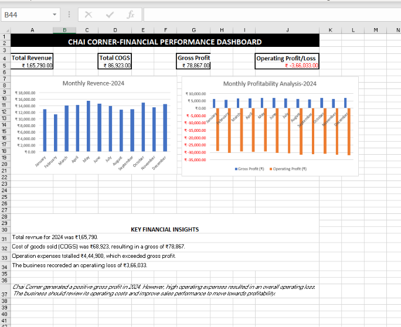
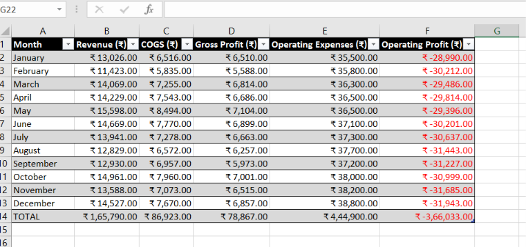
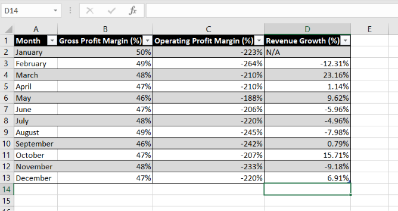

Chai Corner – Retail Business Financial Analysis

An Excel-based financial analysis project for a simulated retail tea shop business.

1. Project Overview

This project analyses the financial performance of a small retail tea shop named Chai Corner, based in Bengaluru, India.

The workbook uses illustrative data for January–December 2024 to examine sales transactions, product costing, operating expenses, profitability and business performance.

2. Project Objectives

- Analyse sales revenue and product costs.
- Calculate gross profit and operating profit or loss.
- Evaluate monthly profitability and revenue growth.
- Prepare a 12-month sales forecast using business assumptions.
- Present financial performance through an Excel dashboard.

3. Tools & Technologies

- Microsoft Excel
- Excel formulas: SUMIFS, SUMIF, INDEX-MATCH and IFERROR
- Financial analysis and reporting
- Data visualisation and dashboards
- ChatGPT (AI-assisted learning and problem-solving)

4. Workbook Structure

Worksheet| Description
|---|---|
Business Overview| Business profile and assumptions
Sales Transactions| Simulated sales transaction records
Monthly Sales Forecast| Estimated customer volume and revenue
Product Costing| Product selling prices, costs and margins
Operating Expenses| Monthly operating cost records
Financial Statements| Monthly revenue, COGS, gross profit and operating profit/loss
Financial Analysis| Profit margins and revenue growth
Dashboard| Financial KPIs, charts and key insights

5. Key Financial Results

Metric| Annual Result
|---|---|
Revenue| ₹1,65,790
Cost of Goods Sold| ₹86,923
Gross Profit| ₹78,867
Operating Expenses| ₹4,44,900
Operating Profit / (Loss)| (₹3,66,033)

Key observation: The simulated business generates a positive gross profit but records an operating loss because operating expenses exceed gross profit.

6. AI Tools & Practical Application

I used ChatGPT (OpenAI) as an AI assistant during different stages of this project.

Practical applications:

- Understanding and troubleshooting Excel formulas.
- Clarifying financial concepts and calculations.
- Structuring financial statements and analysis.
- Developing business assumptions and forecasting methodology.
- Improving dashboard presentation and financial insights.
- Reviewing formulas and checking calculation consistency.

My approach: AI supported my learning and problem-solving. I implemented the formulas, reviewed the outputs, checked calculations and made the final decisions.

7. Key Learning Outcomes

- Practical application of financial accounting and analysis.
- Excel-based financial modelling and reporting.
- Understanding product costing and profitability.
- Revenue forecasting using business assumptions.
- Dashboard development and data visualisation.
- Responsible use of AI tools in everyday analytical work.

8. Important Note

All business information, sales transactions, expenses and financial results in this project are illustrative and simulated. They are created for educational and portfolio demonstration purposes and do not represent actual business records.

---

Project Type: Self-directed Portfolio Project
Reporting Period: January–December 2024
Location: Bengaluru, India
## Project Screenshots

### 1. Financial Performance Dashboard

### 2. Financial Statements

### 3. Financial Analysis

